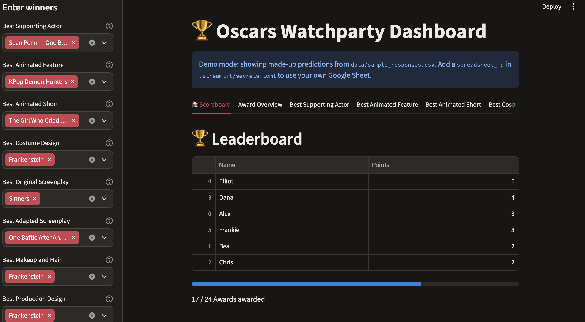
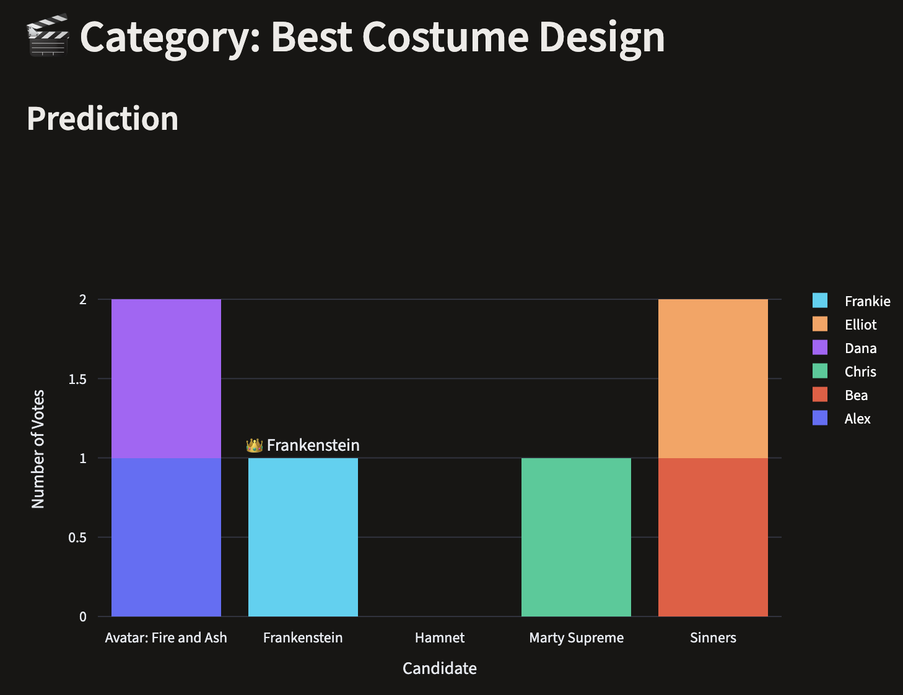
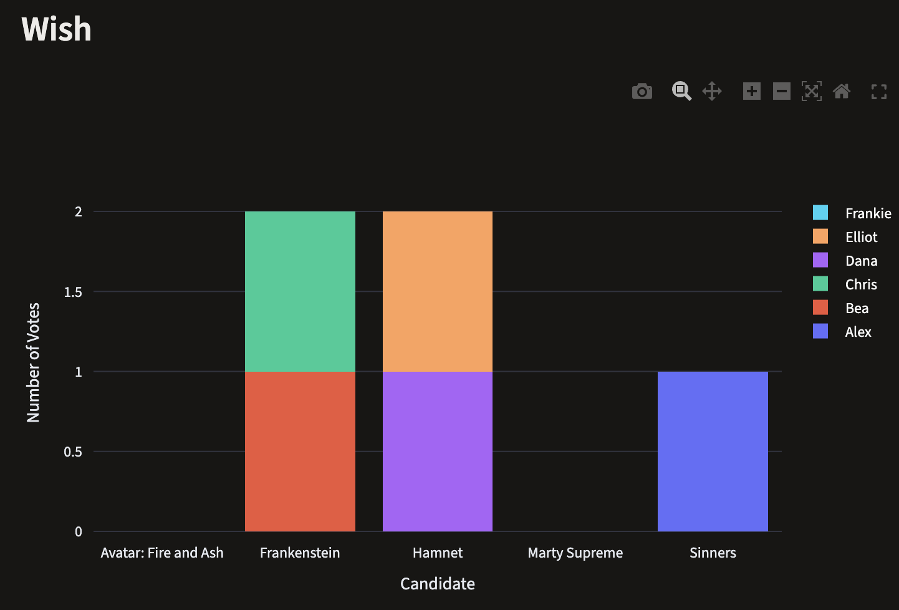
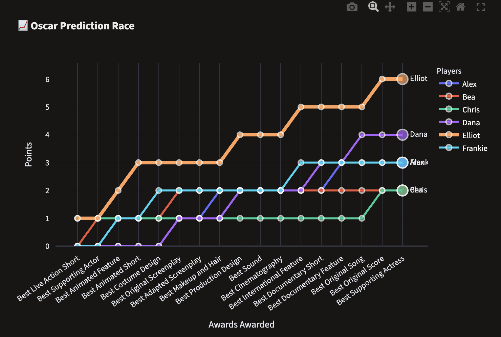
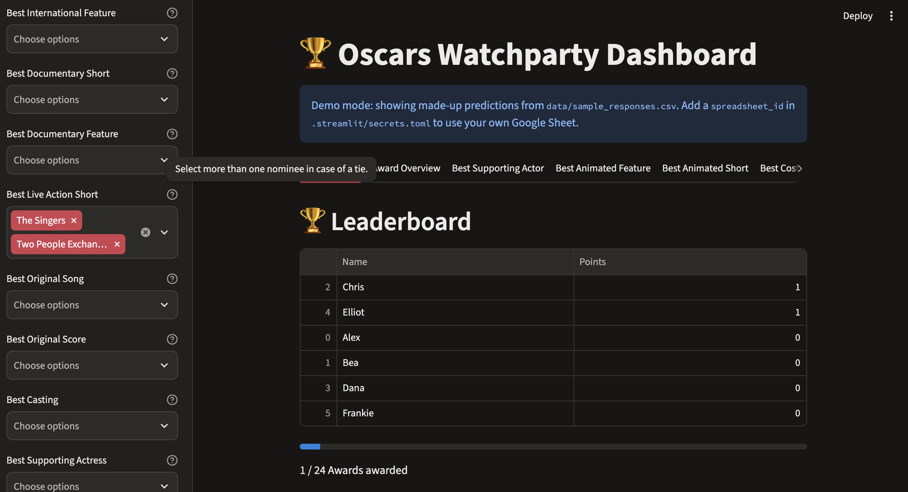
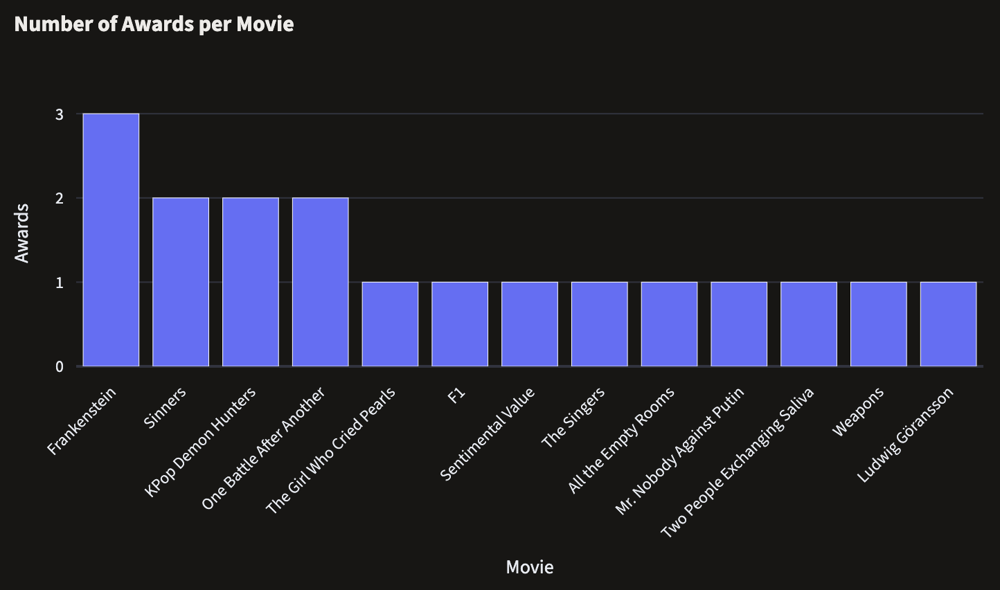

# 🏆 Oscars Watch Party Dashboard



*Screenshots use the built-in demo data – see [Try the demo](#try-the-demo).*

## Why this project?

For the Oscars, a group of friends and I get together for a watch party. Two years ago we were predicting our Oscar picks on a sheet of paper but it was hard to see who everyone picked in all of the chaos that is a night full of fast-paced-award-picks. 
So for the 2026 Oscars, I wanted to go digital and I wanted to have a dashboard we could look at while the predictions are coming in. 
So Beforehand, everyone submitted their predictions via a Google Form – for each category, who we thought *would* win and who we *wished* would win. Because our 2025 Oscar night taught us that those two are often different people. 
The answers landed in a Google Sheet.

During the ceremony, we wanted to enter each winner live as soon as it was announced and instantly see who was right but especially who everyone wanted to see win. So to achieve this, I built this Streamlit dashboard: pick the winner from a dropdown, and the leaderboard, charts and prediction table update on the spot.

## What you need

To just look around, you need nothing but Python – see [Try the demo](#try-the-demo). To use your own party:

- **Python 3.13** and [`pipenv`](https://pipenv.pypa.io) (dependencies are listed in the `Pipfile`)
- **A Google Form + Google Sheet** with the responses, containing:
  - `Zeitstempel` (timestamp) and `Dein Name` (player name)
  - one column per category named `<Category> - Prediction`, and optionally `<Category> - Wunsch` (wish)
- **A Google Cloud service account** with the Sheets API enabled. Download its key as `google_credentials.json` into `scripts/` and share the sheet with the service account's email.
- **`data/Oscar_Options.csv`** – all nominees, one per line: `Category,Nominee — Movie`. Category names must match the sheet columns. (Included for the 2026 Oscars; replace it for other years.)

## Setup & run

```bash
pipenv install
cd scripts
pipenv run streamlit run oscars_dashboard.py
```

## Try the demo

Without any configuration (or with `OSCARS_DEMO=1`, which ignores your `secrets.toml`), the dashboard starts in **demo mode** with made-up predictions from `data/sample_responses.csv` (6 fake players) – no Google account needed:

```bash
cd scripts
OSCARS_DEMO=1 pipenv run streamlit run oscars_dashboard.py
```

`sample_responses.csv` also shows the exact column format your sheet needs.

## Use your own Google Sheet

Configure your sheet: copy `scripts/.streamlit/secrets.toml.example` to `scripts/.streamlit/secrets.toml` (git-ignored) and set your `spreadsheet_id`.

Notes: if someone submits more than once to the google form, only their latest answer counts. Names starting with `Test` are ignored, and empty answers count as abstentions. Each correct prediction is worth 1 point. **Ties:** select several nominees for a category in the sidebar and everyone who picked any of them gets the point. Until our 2026 Oscar night, I had not thought we needed this feature but there were actually two winners for the live action short category! 

## Charts & views

- **Leaderboard** – current points per player, plus a progress bar of awards handed out
- **Prediction Race** – line chart of each player's score after every award, in the order the winners were entered
- **Prediction table** – everyone's picks per category, with correct ones highlighted in green
- **Award Overview** – awards per movie as a table, bar chart and pie chart
- **Category tabs** – stacked bar charts of predictions and wishes per nominee, with the winner marked 👑

| Prediction | Wish |
|:---:|:---:|
|  |  |

### Prediction Race



### Ties

Select more than one nominee in the sidebar and everyone who picked any of them scores.



### Award Overview



## ⚠️ Keep your credentials private

Never commit `google_credentials.json`. Make sure it is listed in `.gitignore`.

## Future ideas

- **Prettier visuals:** replace the quick emoji headings with a custom theme.
- **Automate the setup:** building the Google Form took a long time, because I had to look up every nominee and add pictures for people and movies (in case someone wasn't super familiar with some names). An AI agent could generate `Oscar_Options.csv` and the form from a nominee list.
- **Live refresh:** pick up new form responses without restarting the app.
- **Tests and language settings:** unit tests for the scoring logic, and configurable column names (the sheet is currently German).

## Learnings

- **Streamlit is great for small projects.** I had only used Dash before, which takes more setup. Streamlit let me go from idea to a working dashboard quickly.
- **Real events break assumptions.** I never planned for ties until two films won Best Live Action Short at the 2026 Oscars. Now several winners per category are supported.
